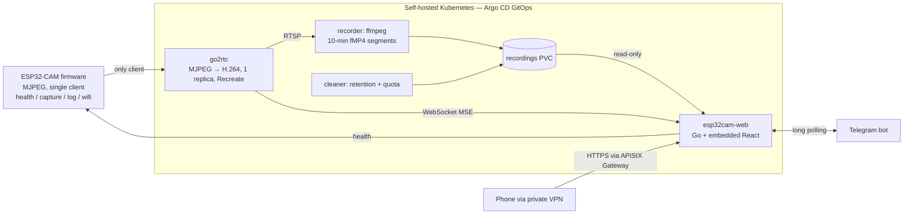

## Problem

I wanted a cheap home camera with continuous recording and remote viewing, without a cloud subscription. The hard constraint is the ESP32-CAM itself:
- it can serve **exactly one** stream client;
- it browns out on weak power;
- it can't do HTTPS.

## Architecture

## How it works

### Firmware
C++/Arduino on ESP32, built with PlatformIO.
- A custom MJPEG streamer serves one client at a time. A second client gets 503 + `Retry-After`.
- Send timeouts and TCP keepalive free a "ghost" client within seconds.
- A frame-dropping double buffer in PSRAM keeps latency from building up.
- Wi-Fi credentials can be changed at runtime and are stored in NVS with a fallback. If the camera loses Wi-Fi it opens a setup access point.
- A log ring buffer in RTC memory survives resets, so logs from just before a crash can be read remotely.

### go2rtc
- go2rtc is the camera's only client and fans the stream out to every viewer.
- It runs as a single replica with the `Recreate` strategy, so a rollout never opens a second connection to the camera.
- A NetworkPolicy allows only go2rtc to reach the camera.

### Recorder
Alpine + ffmpeg 8.
- Stream-copies RTSP into clock-aligned 10-minute **fragmented MP4** segments, so a killed pod loses only the last couple of seconds.
- Uses wall-clock timestamps so durations stay correct after the camera drops out.
- Reconnects with exponential backoff.
- A sidecar cleaner enforces age, quota and node-disk limits.

### Web app
- A single static Go binary with an embedded React 19 UI (`go:embed`), shipped as a ~18 MB distroless, non-root image.
- Features:
  - live view (MSE over WebSocket, proxied so go2rtc is never exposed)
  - recordings browsable by day, with in-browser seeking and download
  - Wi-Fi management
- Login uses an admin form with lockout or Google OAuth (PKCE + email allowlist), with HMAC-signed sessions and a strict CSP.

### Telegram bot
Built into the web app. Commands give a stream link, camera health, the firmware log and a Wi-Fi update flow (the message containing the password is deleted).

### Delivery
- GitLab CI runs lint, then builds the images with buildah.
- A bot commits the new tag to the GitOps repo, and Argo CD rolls it out.
- Secrets come from OpenBao via External Secrets.

### Local test rig
A docker-compose stack with a fake single-client camera reproduces the whole pipeline locally.

## What I learned

- Designing a whole system around a single-client hardware limit: stream fan-out, deployment strategy, NetworkPolicy and firmware enforcement all work together.
- Low-level ESP32 networking: a custom socket server, TCP keepalive, diagnosing brownouts and memory that survives a reset.
- Video plumbing:
  - the cost of transcoding MJPEG to H.264
  - fMP4 for crash-safe files
  - RTP timestamp jumps
  - MSE over WebSocket through an API gateway
- Capacity planning for node-local storage: bitrate to GB per day to retention.
