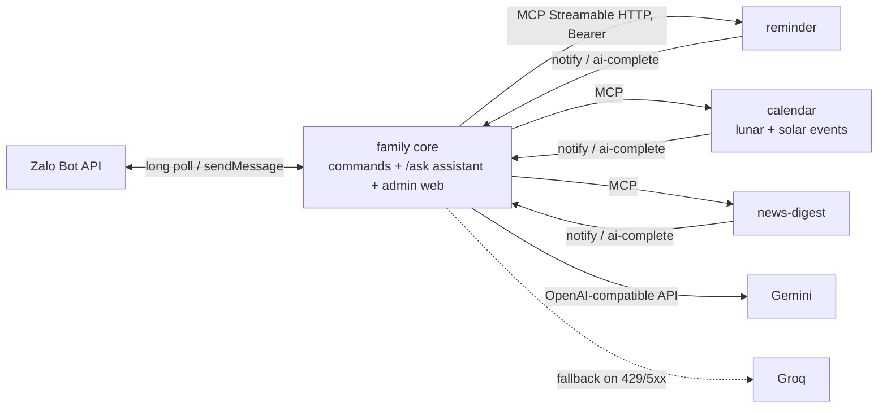

## Problem

My family uses Zalo, not Telegram. They needed reminders, heads-ups before birthdays, death anniversaries and Vietnamese holidays (many of which follow the lunar calendar), and a short daily news digest. All of it had to work inside a group chat, with no buttons, for non-technical users.

## Architecture

This is a fork of my Spidey Bot architecture. The repos, kit package, namespace, secrets and bot are all separate. The connector contract stays nearly identical, so features can move between the two.

## How it works

- **Core** — long-polls the Zalo Bot API with plain `fetch` (no SDK).
  - Notifications are rendered as plain text plus `text_styles` (bold/italic placed by UTF-16 offset), following a written Zalo message standard.
  - Zalo has no buttons and no message editing, so actions appear as copy-pasteable commands and long messages are split into numbered `(i/n)` parts.
- **Calendar connector** — converts between lunar and solar dates offline (UTC+7).
  - Vietnamese public holidays are seeded with their legal references.
  - One combined heads-up per day, with AI suggestions for what to prepare.
- **Assistant (`/ask`)** — OpenAI-style tool calling over every connector's tools.
  - Each connector's hidden `context` tool is preloaded in parallel, so most questions are answered in one round.
  - Actions become short proposals that the requester confirms.
- **Prompt-injection hardening**
  - Tool output is wrapped in tagged data blocks, and fake tags plus invisible/bidi characters are stripped.
  - When a turn carries external content (news), auto-run is turned off for that turn.
  - Nudges catch the model claiming an action it never called a tool for.
- **Provider fallback** — Gemini is primary and Groq is the fallback.
  - `max_tokens` is always set.
  - On a 429 the core switches provider instead of retrying.
- **Admin web** — a React/Vite UI.
  - Login is a one-time link sent by the bot, then an HMAC-signed HttpOnly session cookie.
  - Strict CSP and Origin checks on POST.

## What I learned

- Porting one architecture to a much more limited messaging platform (no buttons, no edits, string IDs, short messages) while keeping the connector contract almost the same.
- Practical LLM reliability: provider fallback chains, working within free-tier rate limits, prompt-injection defenses, and catching tool calls the model claims but never makes.
- Domain modeling for Vietnamese lunar dates (leap months, short months), tested against known holiday dates.
