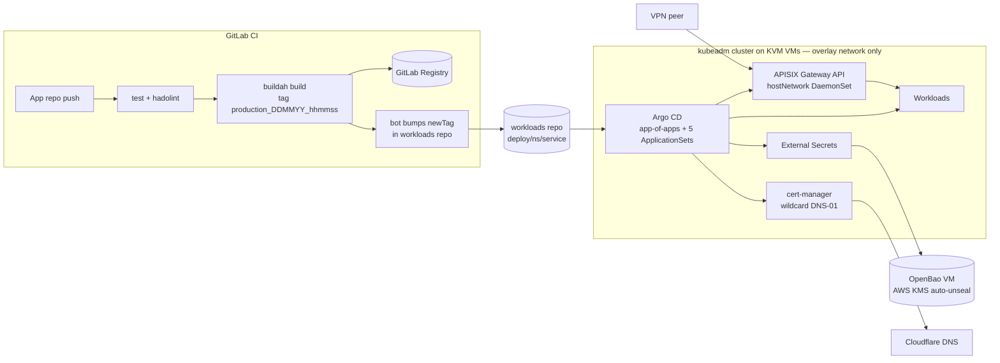

## Problem

I wanted a production-like platform for my own services (chat bots, MCP connectors, dashboards) without a cloud bill and without exposing nodes to the internet. The machines only share a private WireGuard mesh, there is no cloud load balancer, and hosted CI runners can't reach the nodes. Shipping a new version still had to be nothing more than `git push`.

## Architecture

## How it works

- **Provisioning** — Terraform (libvirt provider) creates Ubuntu cloud-image VMs with cloud-init. Ansible installs containerd, kubeadm and Calico (VXLAN), then joins the workers. Every node is pinned to its NetBird (WireGuard) interface: kubelet `--node-ip`, Calico autodetection and an MTU sized for the tunnel overhead. Preflight assertions fail fast if a node is pointed at the wrong interface.
- **CI that reaches private nodes** — a shared GitLab CI template joins the job to NetBird in userspace netstack mode and exposes a SOCKS5 proxy, which Ansible's SSH goes through. The job's temporary peer is removed afterwards.
- **GitOps** — a root Argo CD app bootstraps the AppProjects and ApplicationSets:
  - **infra:** upstream Helm charts with their values kept in Git.
  - **routes:** Kustomize Gateway API manifests.
  - **apps:** a git directory generator over `deploy/<namespace>/<service>`. Adding a service means adding a folder, and deleting the folder prunes it.
- **Ingress & TLS** — APISIX runs as a hostNetwork DaemonSet that implements the Gateway API. cert-manager issues a single wildcard Let's Encrypt certificate through Cloudflare DNS-01, so a new route needs no DNS or certificate work.
- **Secrets** — nothing is committed. External Secrets authenticates to an external OpenBao VM using Kubernetes service account tokens. OpenBao is deployed by Ansible and auto-unseals through AWS KMS.
- **Delivery** — versioned, reusable CI templates run: test, buildah image build, then a bot commit that bumps the image tag in the workloads repo. Argo CD rolls it out, and rollback is a `git revert`.
- **Observability** — kube-prometheus-stack with Grafana (Google sign-in), also scraping the KVM host (node, SMART, libvirt exporters).

## What I learned

- Overlay-only networking breaks defaults quietly. Kubelet node IPs, Calico interface detection and MTU all had to be pinned explicitly.
- ApplicationSet-generated apps ignore sync waves, so CRD ordering is handled with retries and server-side apply/diff instead.
- Not everything should auto-sync. Argo CD manages its own config but is synced by hand, so a bad values change can't lock me out.
- Single-node trade-offs (node-local storage, DNS round-robin instead of a load balancer) are documented together with their failure modes and upgrade paths.
