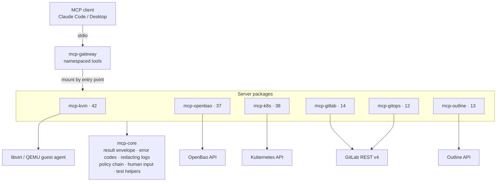

## Problem

I wanted AI agents (Claude Code / Claude Desktop) to do real work in my homelab: create VMs, set up secrets, debug Kubernetes, propose GitOps changes and keep the wiki current. I didn't want to give them a shell. Generic "run this command" tools are unsafe because the model can leak secrets into the transcript, edit raw backend definitions, or push directly to a branch that Argo CD deploys.

## Architecture

## How it works

- **Shared core.** Every server is built on `mcp-core`, which provides:
  - one `ToolResult`/`ToolError` envelope;
  - strict input validation with no type coercion;
  - required tool annotations (read-only, mutating, destructive);
  - JSON logs with secret redaction scoped to each request.
- **Tools are tasks, not shells.** Tools are high-level and idempotent. None of them run arbitrary shell commands or accept arbitrary paths, URLs or raw backend definitions. KVM day-1 setup goes through an allowlist of guest-agent commands.
- **Policies run before every write.** An immutable policy chain is built from settings at startup and checked before each mutating call:
  - KVM allows NAT networking only.
  - Kubernetes is read-only by default. When writes are enabled they default to `dryRun=All` and return a field diff.
  - GitOps only writes to `ai/` branches. The HTTP client enforces this on every request, and there is no merge code path.
  - OpenBao break-glass endpoints are blocked by path.
- **Humans own secrets.** VM logins and NetBird setup keys are typed by the operator through MCP elicitation. Both protocol eras are supported. The model never generates or sees these values.
- **Gateway.** Servers are discovered through Python entry points, and any subset can be mounted behind one endpoint with namespaced tool names.
- **Quality gates.** Every push runs ruff, `mypy --strict` and pytest against in-memory fakes. CI also checks that the generated tool reference still matches the code.

## What I learned

- Safety rules hold up better in the server's code and type system than in the prompt: a client that only has `get()`, a branch prefix checked on every request, and tools that are simply not registered when a mode is off.
- Designing tool surfaces for LLMs:
  - tool descriptions written in plain language;
  - structured error codes the agent can act on (`REVISION_CONFLICT`, `OUTCOME_UNKNOWN`, `PERMISSION_DENIED`) instead of a vague "not found";
  - repository text treated as untrusted, to defend against prompt injection.
- Spec-driven development with an AI coding agent: I designed and wrote a top-level spec plus one spec per server, and the code is held to them by strict typing and a large fake-backed test suite.
