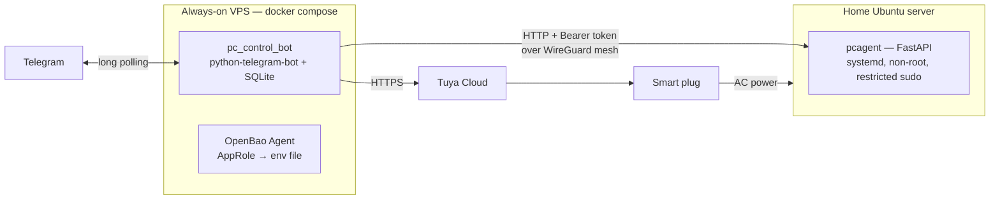

## Problem

My home server isn't on 24/7, but I still need to start it, shut it down cleanly, check on it and patch it from my phone, even when it's off or has lost power. A bot that runs *on* the server can't turn the server back on.

## Architecture

The project has two parts:
- **pc_control_bot** runs in Docker Compose on an always-on VPS.
- **pc_control_agent** is a FastAPI service on the home server.

They talk over a private NetBird (WireGuard) mesh, authenticated with a Bearer token. Power is switched through a Tuya smart plug, and the BIOS is set to power on when AC returns.

## How it works

- **Power on.** `/pc_start` reads the plug's wattage. If the PC is off, it cycles the plug, then polls the agent's `/health` for up to 3 minutes.
- **Power off.** `/pc_stop` schedules a shutdown with a 60-second Cancel button. It waits until power draw stays under a threshold for 30 seconds, then cuts the plug. `/pc_forcestop` requires an explicit confirmation.
- **Agent API.** A fixed set of endpoints: info, boot report, disk + SMART, top processes, whitelisted services with restart and logs, and apt updates. There is **no endpoint that runs arbitrary commands**.
- **Background monitor (every 60 s).** Watches:
  - online/offline state
  - failed services
  - disk usage
  - CPU temperature
  - sustained load
  - lost contact with the plug

  It also cuts power automatically if the host has been off for 10 minutes with the plug still on, and sends a boot report and a daily report.
- **Scheduling & energy.** Daily or one-off start/stop/reboot schedules are stored in SQLite. The bot also estimates kWh and cost.
- **Delivery.**
  - Both repos run lint (ruff, shellcheck, hadolint) and pytest in GitLab CI.
  - The bot image is built with buildah. A manual job deploys it over the mesh using a temporary peer.
  - The agent is released into versioned directories with a symlink switch, a `/health` self-test and automatic rollback.

## What I learned

- Least privilege for a host agent:
  - It listens only on the private interface and compares tokens in constant time.
  - sudo is limited to a whitelist with fixed arguments.
  - systemd sandboxing is tuned to what `sudo` and `smartctl` actually need.
- Why `apt upgrade` must run in its own systemd unit, so restarting the agent mid-upgrade can't kill `dpkg`.
- Keeping control separate from the thing being controlled: the bot lives off-box and caches its secrets, so it still starts while the home server is off.
- Alerting UX: severity levels, deduplication and FIRING/RESOLVED pairs.
