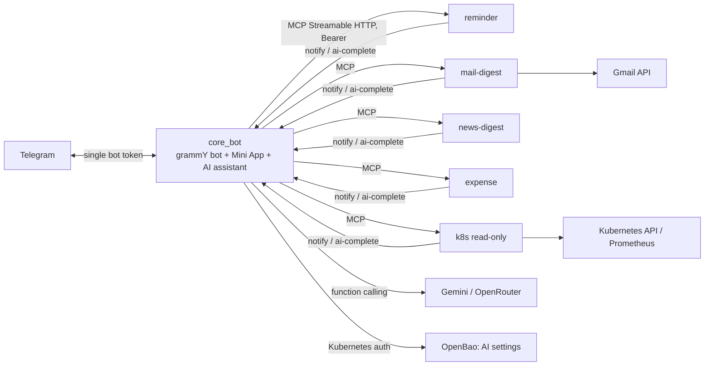

## Problem

I had several single-purpose Telegram bots (reminders, mail digest, …). Each one had its own bot token, its own AI key and its own message format, and every new feature meant writing yet another bot. I wanted one assistant where a new capability is a small service I plug in, and where an LLM can use all of them without me writing glue code each time.

## Architecture

## How it works

- **Core**
  - The core is the only process that holds the Telegram token and the AI keys.
  - It long-polls Telegram with grammY, serves a React Mini App and runs the LLM assistant.
- **Connectors**
  - Each connector is a stateless MCP server (Streamable HTTP, Bearer token compared in constant time).
  - Tools declare JSON-Schema inputs plus `_meta` hints: read-only, destructive, confirm text, slash command, or hidden from the AI.
  - The core discovers tools at runtime and turns them into Mini App forms and tables, auto-registered Telegram slash commands, inline buttons and functions the assistant can call.
- **Shared contract**
  - Types, an MCP server factory and the client for calling back into the core live in a versioned npm package (`spidey-kit`).
  - The package is published to a private GitLab Package Registry.
- **Assistant safety**
  - Read-only tools run immediately.
  - Actions become proposals that only the requester can confirm, and they expire after 10 minutes.
  - Tools that touch secrets or OAuth are never exposed to the model.
- **Messaging standard**
  - Connectors send structured notifications with severity, status, facts and an alert id.
  - The core renders them as Telegram HTML per a written spec: firing/resolved matching, silent INFO messages and message splitting.
- **Delivery**
  - GitLab CI runs test, hadolint and a buildah build, then bumps the image tag in the GitOps repo.
  - Argo CD deploys the new tag to Kubernetes.
  - Containers run as non-root, with data on a PVC.

## What I learned

- Designing a small, versioned protocol (MCP plus a `_meta` vocabulary) so that one tool definition drives a chat command, a button, a web form and an LLM function.
- Keeping an LLM agent safe: confirmation for actions, read-only vs destructive hints, and keeping secret-bearing tools away from the model.
- Defense in depth for a read-only Kubernetes integration: a GET-only client, a blocklist of resources and a restricted RBAC ClusterRole.
- Running stateful bots reliably on Kubernetes: schedulers with no in-memory timers that survive restarts, and health checks that catch a stuck scheduler loop.
