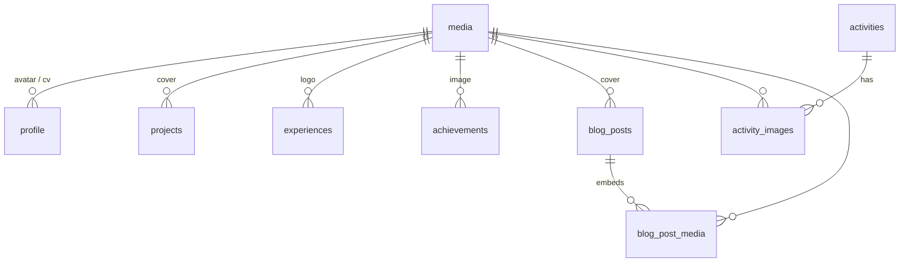
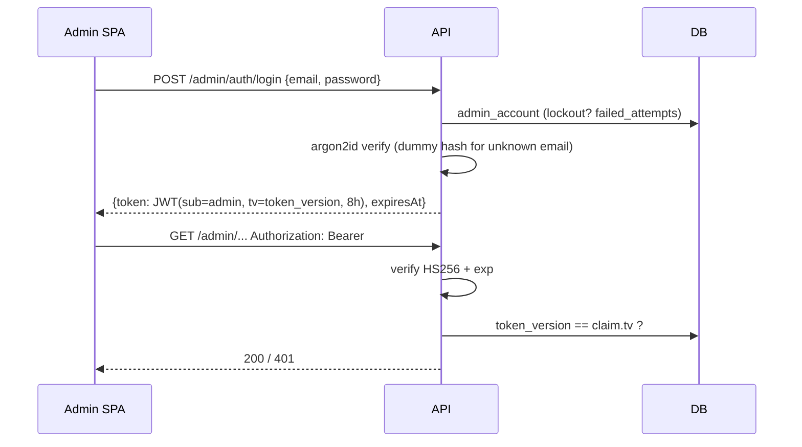

# System design — trngnneee portfolio

How the rebuilt portfolio works: what runs where, how data flows, and why it was built this way.
Setup and deployment commands are in the [README](../README.md).

## 1. Overview

```mermaid
flowchart LR
  V[Visitor] -->|HTTPS| WEB[portfolio-web<br/>static SPA · Render]
  A[Admin] -->|HTTPS| ADM[portfolio-admin<br/>static SPA · Render]
  WEB -->|GET /api/v1/public/*| API[portfolio-api<br/>Express 5 · Render]
  ADM -->|Bearer JWT /api/v1/admin/*| API
  WEB -. /sitemap.xml rewrite .-> API
  API -->|session pooler · TLS| DB[(Supabase Postgres)]
  API -->|upload / destroy| CLD[(Cloudinary)]
  WEB -->|f_auto,q_auto,w_…| CLD
  API -.->|contact notification| RS[Resend]
```

- **One API, two frontends.** The public site and the admin are separate static sites on separate origins.
  The API is the only component with credentials.
- **Single admin.** No user table, no roles: one `admin_account` row, created from the CLI.
- **Content is data.** Everything on the public site (profile, sections, projects, blog…) lives in Postgres and
  is edited in the admin. Nothing is hard-coded in the frontend.

## 2. Repository

```
shared/     zod schemas (inputs), API response types, enums, SECTION_KEYS — built to dist/, used by all
markdown/   @portfolio/markdown — one renderer for the public site AND the admin preview (source-only)
backend/    Express API, Drizzle schema + migrations, seed, CLI, tests
frontend/   public SPA
admin/      admin SPA (Astryx design system; deviations in admin/DEVIATIONS.md)
render.yaml Render Blueprint (3 services)
```

Type safety crosses the wire: backend DTO builders are typed against `shared/src/api.ts`, frontends read the
same types, and both sides validate inputs with the same zod schemas.

## 3. Data model



| Table                                                                             | Notes                                                                      |
| --------------------------------------------------------------------------------- | -------------------------------------------------------------------------- |
| `admin_account`                                                                   | Singleton: email, argon2id hash, `token_version`, lockout counters         |
| `site_sections`                                                                   | 9 fixed keys (`hero` … `contact`): enabled, labels, order                  |
| `profile`                                                                         | Singleton: identity, bio (markdown), contact, avatar/CV media              |
| `projects`, `experiences`, `achievements`, `activities`, `skills`, `social_links` | Ordered (`sort_order`), `published` flag                                   |
| `blog_posts`                                                                      | `draft`/`published`, `reading_minutes` computed on save, tags (`jsonb`)    |
| `blog_post_media`                                                                 | Media referenced inside post markdown (re-derived on every save)           |
| `media`                                                                           | Cloudinary assets: `public_id`, URL, size, alt, folder                     |
| `contact_messages`                                                                | `new`/`read`/`archived`, `ip_hash` (sha256 + salt), never exposed publicly |

Conventions: identity PKs, `timestamptz` (ISO strings in the API), `jsonb` for small string lists, enums as
`text` guarded by zod. Migrations are Drizzle SQL files in `backend/drizzle/`, applied on API start.

**Media lifecycle.** A media row is "in use" if any FK, gallery link or post body references it. When content
stops referencing an image (cover replaced, project deleted, image removed from markdown), the orphan row and
its Cloudinary asset are deleted. Deleting media that is still used returns `409`.

## 4. API

Prefix `/api/v1`. Errors are always `{ error: { code, message, details? } }`; all input is parsed with zod.

**Public** (`/public/*`, no auth, read-only):

| Route                                       | Behaviour                                                                                                                                                                                                                            |
| ------------------------------------------- | ------------------------------------------------------------------------------------------------------------------------------------------------------------------------------------------------------------------------------------ |
| `GET /site`                                 | One call for the whole site: enabled sections (ordered), profile, links, and data of enabled sections only. Disabled section → its data is absent. Stats are derived. `Cache-Control: max-age=60, stale-while-revalidate=600` + ETag |
| `GET /blog`, `/blog/:slug`, `/blog/rss.xml` | Published posts only; `404` when the blog section is off                                                                                                                                                                             |
| `POST /contact`                             | zod validation, honeypot (fake success), 5 req / 15 min / IP, `404` when contact is off                                                                                                                                              |
| `GET /sitemap.xml`, `GET /healthz`          | Sitemap of enabled routes + posts; health pings the DB                                                                                                                                                                               |

Public responses are built by explicit DTO mappers (`modules/public/*`), never raw rows: no drafts, unpublished
items, private repo URLs, IP hashes or unused media can leak.

**Admin** (`/admin/*`): CRUD + reorder for each content type, publish/unpublish, activity galleries, media
upload/library, inbox, sections, profile, dashboard metrics, JSON export, auth endpoints.

## 5. Authentication & authorization



- `requireAuth` is mounted **once** in front of every admin route except login. A test walks the router's route
  table and asserts every route returns `401` without a token, so new routes can't skip auth.
- Brute force: 10 login requests / 15 min / IP, and 5 consecutive failures lock the account for 15 minutes (`423`).
- Revocation: password change and "sign out everywhere" increment `token_version`, invalidating all JWTs at once.
- The token lives in `sessionStorage` (cleared with the tab). Admin and API are different sites, so cookies
  (and CSRF) are avoided entirely.
- Authorization is the public/admin split: the public surface is read-only DTOs; the admin surface is
  all-or-nothing behind `requireAuth`.

## 6. Security

| Layer        | Measures                                                                                                                                                                          |
| ------------ | --------------------------------------------------------------------------------------------------------------------------------------------------------------------------------- |
| API          | helmet (CSP, HSTS, nosniff…), CORS allowlist, 1 MB JSON limit, zod on every input, parameterized SQL (Drizzle), digits-only ids, LIKE wildcards escaped                           |
| Uploads      | multer memory storage, magic-byte sniffing (jpg/png/webp/avif/pdf only; SVG/HTML rejected), per-type size limits, server-generated names, folder allowlist                        |
| Content      | Markdown sanitized (`rehype-sanitize` before highlighting), `javascript:` URLs dropped, mermaid in `strict` mode, http(s)-only links in data                                      |
| Static sites | CSP (`script-src 'self'`, `connect-src` = API, images from Cloudinary/jsDelivr only), `X-Frame-Options: DENY`, HSTS, nosniff, Referrer-Policy; admin adds `X-Robots-Tag: noindex` |
| Database     | Supabase via session pooler with TLS (optional CA verification); **RLS enabled on every table** so Supabase's Data API exposes nothing; the API's owner role bypasses RLS         |
| Logs         | pino with `authorization` and password fields redacted                                                                                                                            |
| Dependencies | `npm audit --omit=dev` gate in CI; lockfile committed                                                                                                                             |

`backend/test/security.test.ts` covers injection, traversal, JWT forgery (`alg: none`, wrong secret, HS512),
mass assignment, prototype pollution, malicious uploads, output escaping, CORS and error leakage.

## 7. Public site (`frontend/`)

- Routes and navigation are generated from `sections`. A route renders only if one of its sections is enabled;
  otherwise it renders the terminal-style 404.
- Route-level code splitting; the markdown renderer (highlight.js) and mermaid load only where used.
- "Cyber terminal" design: a single Tailwind v4 `@theme` token set, `TerminalHeader`, `Typewriter` (respects
  reduced motion, reserves its size to avoid layout shift), skills terminal (`help/ls/cat/whoami/clear`).
- A11y: skip link, `aria-current` nav, labelled form fields with `aria-invalid`/`aria-describedby`, live regions,
  native `<dialog>` (focus trap, Esc). SEO: per-route title/OG/canonical, JSON-LD `Person` + `BlogPosting`,
  robots.txt and sitemap. Lighthouse (production build): accessibility 100, SEO 100 on all pages.
- Images: Cloudinary `f_auto,q_auto` with `srcset`, explicit width/height, lazy below the fold.

## 8. Admin (`admin/`)

Built on the Astryx design system following `SYSTEM_DESIGN_ADMIN_DASHBOARD.md` (shell, `ROUTES`, `NAV_SECTIONS`,
page patterns, `DataTable`, imperative delete confirmations, toasts, vi/en i18n). Server state is in TanStack
Query (`features/*/api.ts`). Custom components (`MediaPicker`, `MarkdownEditor`, `TagsInput`) are composed from
Astryx parts. Every deviation is listed in [`admin/DEVIATIONS.md`](../admin/DEVIATIONS.md).

## 9. Deployment

| Component                          | Where                                                  | Notes                                                                                   |
| ---------------------------------- | ------------------------------------------------------ | --------------------------------------------------------------------------------------- |
| `portfolio-api`                    | Render web service (Node 22, **free** plan, Singapore) | Build with dev deps, migrate on start, `/healthz` health check; sleeps when idle (free) |
| `portfolio-web`, `portfolio-admin` | Render static sites                                    | SPA rewrite, immutable `/assets/*`, security headers, `/sitemap.xml` proxied to the API |
| Database                           | Supabase (Singapore)                                   | Session pooler (IPv4), TLS, RLS, pool max 5                                             |
| Media                              | Cloudinary                                             | Folder per content type, seed assets under `portfolio/seed/`                            |

The API is stateless (JWT + Postgres + Cloudinary), so it could run several instances. The only per-instance
state is the in-memory rate limiter.

## 10. Testing & CI

| Package  | Tests                                                                                             |
| -------- | ------------------------------------------------------------------------------------------------- |
| backend  | supertest against real Postgres (one database per file): auth, visibility, content, security, RLS |
| markdown | rendering, sanitization, TOC ids                                                                  |
| frontend | units (Cloudinary URLs, nav, terminal) + routed UI (section gating, contact form a11y)            |
| admin    | validation mapping, API client 401 handling, guard/login/lockout, list page                       |

GitHub Actions: `npm ci` → `npm audit --omit=dev` → lint → typecheck → tests (Postgres service container) → build.

## 11. Decisions & trade-offs

| Decision                             | Why                                                                           | Cost                                                                                      |
| ------------------------------------ | ----------------------------------------------------------------------------- | ----------------------------------------------------------------------------------------- |
| SPA + API instead of SSR             | Simple static hosting, admin-driven content without rebuilds                  | Crawlers without JS see only static meta (mitigated by index.html tags, sitemap, JSON-LD) |
| Postgres on Supabase                 | Managed, free tier, backups; Render hosts only stateless services             | Free tier pauses when idle; must keep RLS on for the Data API                             |
| JWT in `sessionStorage` (no cookies) | Cross-site admin/API, no CSRF surface, instant revocation via `token_version` | One DB read per admin request (single small row)                                          |
| One `/public/site` payload           | One round trip, easy caching, section gating in one place                     | Payload grows with content (fine at portfolio scale)                                      |
| Shared markdown package              | Admin preview is exactly what the site renders                                | One more workspace                                                                        |
| Single admin, no RBAC                | Matches the real use                                                          | Not multi-user by design                                                                  |
